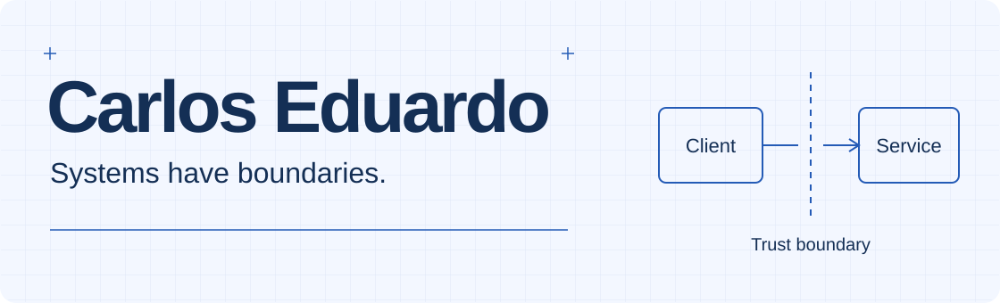

<picture>
  <source media="(max-width: 600px) and (prefers-color-scheme: dark)" srcset="./assets/profile-mobile-dark.svg">
  <source media="(max-width: 600px)" srcset="./assets/profile-mobile-light.svg">
  <source media="(prefers-color-scheme: dark)" srcset="./assets/profile-dark.svg">
  
</picture>

# Carlos Eduardo

I'm a **software engineer and architect**, currently working at **CBOO**.
I work across software design, APIs and product interfaces, with a particular
interest in how systems behave at their boundaries.

I'm looking for my **first junior penetration testing or offensive security
opportunity**. I'm also open to **remote software engineering, architecture
and development roles**.

My [portfolio](https://cesaints.dev/en) brings together my background,
sanitized case studies and visual demonstrations with fictional data.

## Selected public work

Two repositories offer a focused starting point for reviewing my work.
Each has a specific scope and visible limitations.

### [NexusData](https://github.com/cesaints/nexusdata)

An asynchronous data-processing project using **FastAPI, Celery, RabbitMQ
and PostgreSQL**. Designed around tenant-scoped processing, idempotency and
signed webhooks. The processing adapter is currently a mock. See the
repository README for implementation details and current project status.

### [Marketing Digital](https://github.com/cesaints/marketing-digital)

A **Next.js and TypeScript MVP** for simulating ROI, ROAS and CAC from supplied
inputs. Products and simulations persist in the browser; live advertising
analytics are not integrated. The figures are calculations based on the
user's assumptions, not measured campaign results.

These projects show different concerns: processing work across services,
and making business calculations understandable in an interface. My other
repositories document learning exercises and experiments.

## Security, in progress

I'm studying **Solyd ONE**, **curso.dev** and **Angela Yu's Python bootcamp**. Both are
in progress. I'm strengthening my Python foundations while building the
knowledge for an entry-level offensive security role.

I'm interested in scoped, evidence-based testing and clear reports that
engineering teams can act on. I want to connect my software background
with a disciplined approach to understanding and testing trust boundaries.

## Background and contact

My CTO/CPO roles at **+55Hub** and **Distópico** ended on **13 October 2026**.
The [public career timeline](https://cesaints.dev/en/career) gives the wider
context without tying private systems to named companies.

**Portuguese:** native. **English:** intermediate.

For opportunities or a conversation about my work, contact me on
[LinkedIn](https://www.linkedin.com/in/carlossaints/) or by
[email](mailto:cesaints.engineer@gmail.com).
